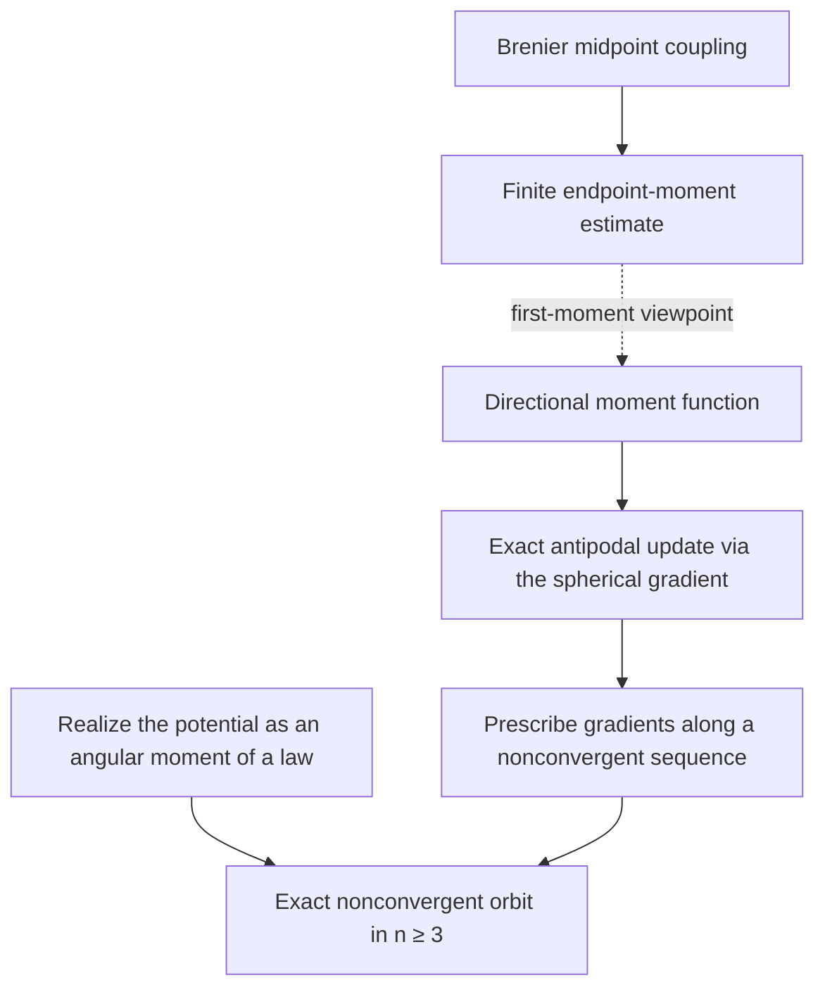

# Nonconvergence of two-site population Lloyd iteration

For every dimension $n\geq3$, a smooth, centrally symmetric, positively curved body can be chosen arbitrarily close to the Euclidean ball in any prescribed finite differentiability norm, yet the exact two-site population Lloyd iteration for its uniform law need not converge. One antipodal start yields an orbit whose unordered pairs accumulate at one common radius on **every** equatorial axis. All these limit configurations are stationary. Ordinary and optimal equal-mass updates give the same orbit.

$$
\operatorname{Clust}
= \big\{\{\pm c(w,0)\}:w\in S^{n-2}\big\}
\cong \mathbb{RP}^{n-2},
\qquad c>0.
$$

The paper also gives examples with a smooth isotropic strongly log-concave Gaussian perturbation and a smooth compactly supported log-concave density. For centrally symmetric absolutely continuous planar laws with finite first moment and a twice continuously differentiable angular moment, the ordinary iteration converges from every nonzero antipodal start.

## The proof idea

For an even law, set $H(u)=\mathbb E|u\cdot X|$. The next positive site at direction $u$ is $H(u)u+\nabla_S H(u)$. To steer it to the next unit direction $v$ with $u\cdot v>0$, prescribe

$$
\nabla_S\log H(u)=\frac{v}{u\cdot v}-u.
$$

The construction chooses a sequence approaching every equatorial direction, prescribes these gradients along it, and realizes the potential as the angular moment of a probability law.

## Where the proof came from

We extracted a finite cell-moment comparison from the midpoint coupling in [the OpenAI Brenier preprint, Section 4](https://github.com/openai/math/blob/4eaee87548250b2682affda7d05d947c05554bae/preprints/Sharp-One-Third-Stability-of-Brenier-Maps-September-25-2026/build/source/sections/moments.tex#L8-L32). It shortened the original stability proof and gave a certificate for one inexact Lloyd step. This led us to ask whether exact Lloyd steps must converge.

We kept the same starting quantity, the first moment of a cell. For an antipodal pair it is a hemisphere moment, and the directional moment function $H$ encodes the exact update through its spherical gradient. We used this form to construct a nonconvergent orbit in three dimensions, then extended the orbit construction and moment realization to every $n\geq3$. The exact proof uses the directional identity above rather than the finite harmonic-mean bound for comparing cells. This record does not assert historical priority.

## What the orbit proof uses

The dotted arrow records where the idea came from. The orbit proof uses the exact hemisphere-update identity, not the finite comparison bound.

## Further applications of the Brenier tool

The [Brenier endpoint-moment tool page](notes/brenier-endpoint-moment-tool.md) links the original estimate and two subsequent notes: velocity comparison for semi-geostrophic vortex patches, and sequential multivariate rank estimation. The first uses the endpoint estimate directly; the second was inspired by it and admits a shorter direct proof.

## Files

- [Preprint PDF](Lloyd_preprint.pdf): the complete argument, its scope, and literature comparison.
- [Research-path diagram](Lloyd_Research_Path.html): the development from transport comparison to the exact-orbit theorem. Download and open locally if GitHub shows the HTML source.
- [Brenier endpoint-moment tool (PDF)](Brenier_Endpoint_Moment_Tool.pdf)
- [Lean reproduction packet](Lloyd_Lean_Reproduction.zip): local source, pinned toolchain and dependencies, verification scripts and archived logs. Start with the README inside it. The central declaration is `LloydNDVerified.projective_lloyd`. It verifies the mathematical existence statement by a related formal construction, not the manuscript’s literature assessments.

Lean and mathlib and the other upstream dependencies listed in the packet’s `lean/lake-manifest.json` are fetched separately, remain subject to their own upstream licenses and notices, and are not redistributed here.
