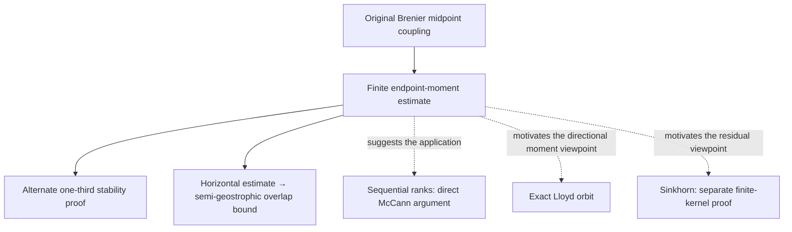

# The Brenier endpoint-moment tool

The [technical note (PDF)](../Brenier_Endpoint_Moment_Tool.pdf) extracts a finite comparison of raw cell moments from the midpoint coupling in [Section 4 of the source preprint](https://github.com/openai/math/blob/4eaee87548250b2682affda7d05d947c05554bae/preprints/Sharp-One-Third-Stability-of-Brenier-Maps-September-25-2026/build/source/sections/moments.tex#L8-L32). Under uniform volume on a compact convex body, the estimate compares two collections of power cells at the same sites, including cells that vanish at one endpoint. It replaces the differentiated cell-mass calculation in an alternate proof of the same one-third stability theorem.

## Which results use the estimate?

Solid arrows mean that the argument uses the estimate; dotted arrows are motivation. [Community submission #87](https://github.com/mathcommunity/oai-math-revised/issues/87) records the comparison and its downstream uses.

## What the idea led to

| Note | What is proved | Role of the tool |
| --- | --- | --- |
| [Velocity comparison for semi-geostrophic vortex patches](semigeostrophic-vortex-patches.md) | For the stated patch class, conserved horizontal impulse controls the velocity error on the overlap with a circular rearrangement. | The horizontal endpoint estimate turns density control from rearrangement into velocity control. |
| [Sequential multivariate rank estimation](sequential-multivariate-ranks.md) | A prediction-to-rank error bound, with examples matching the growth rates of the upper bounds. | The endpoint estimate suggested the application. The shorter proof in the note uses McCann's change of variables directly. |
| [Nonconvergence of two-site Lloyd iteration](../README.md#where-the-proof-came-from) | An exact two-site orbit need not converge in dimension three or higher. | The first-moment viewpoint motivated a directional identity; the exact orbit proof does not use the finite bound. |
| [Full-plan error bounds for Sinkhorn](sinkhorn/README.md) | Bounds the entire returned entropic transport plan from an intermediate marginal residual; gives two stopping probes. | The shared residual-measure viewpoint motivated the new finite-kernel proof; the earlier Brenier theorem is not a premise. |

The follow-ups make no priority claim. They should not be read as further improvements to the original one-third stability theorem.
